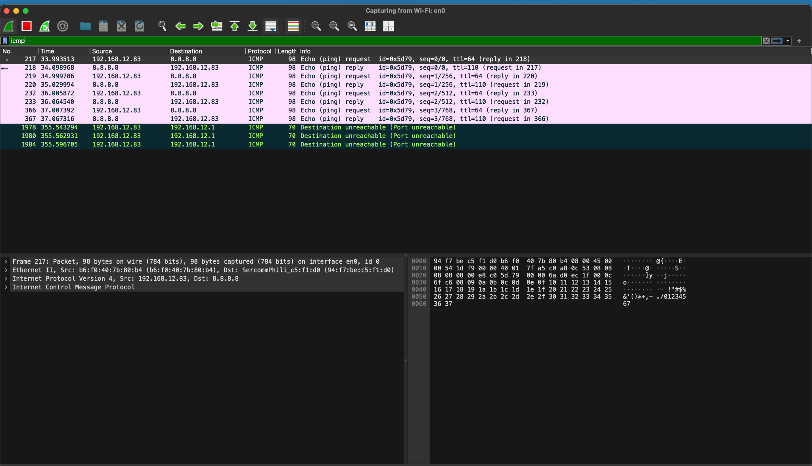
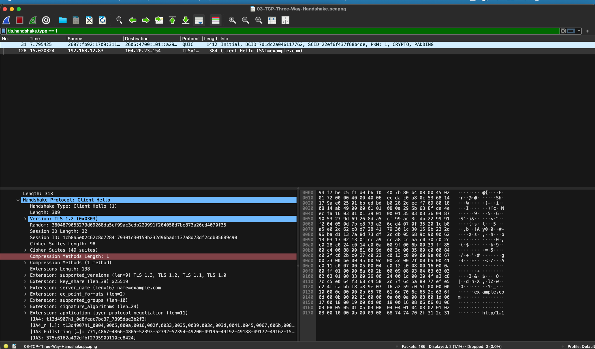
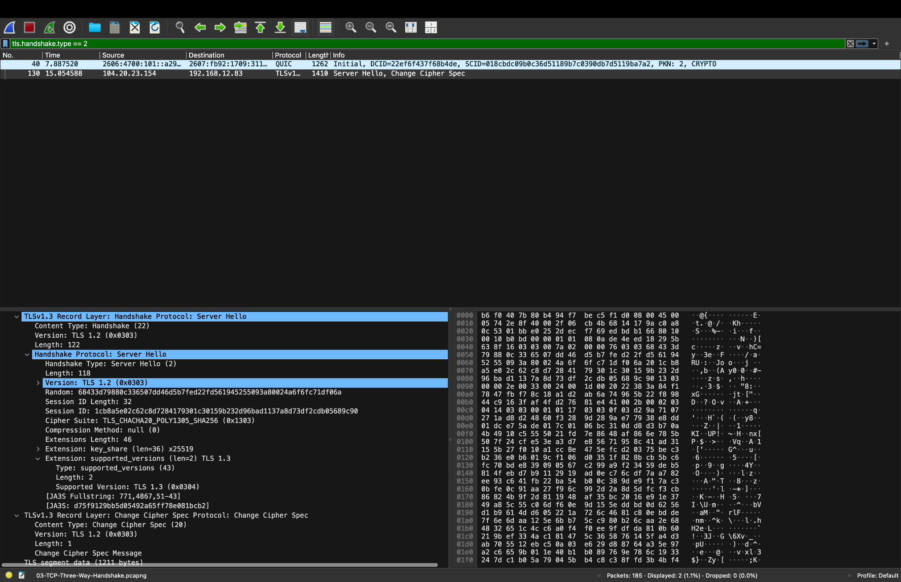
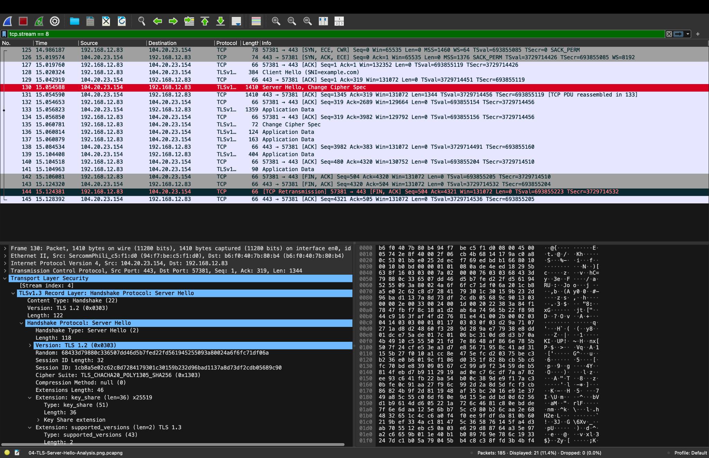
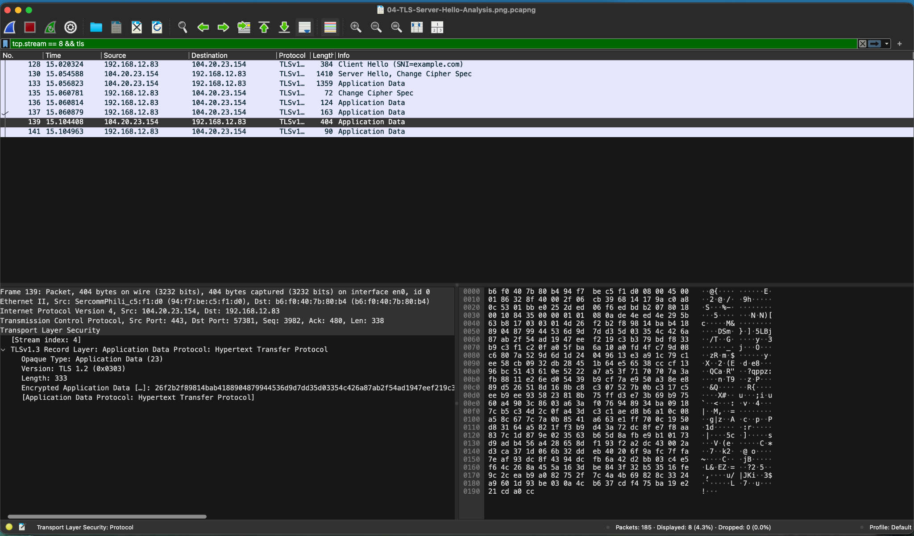
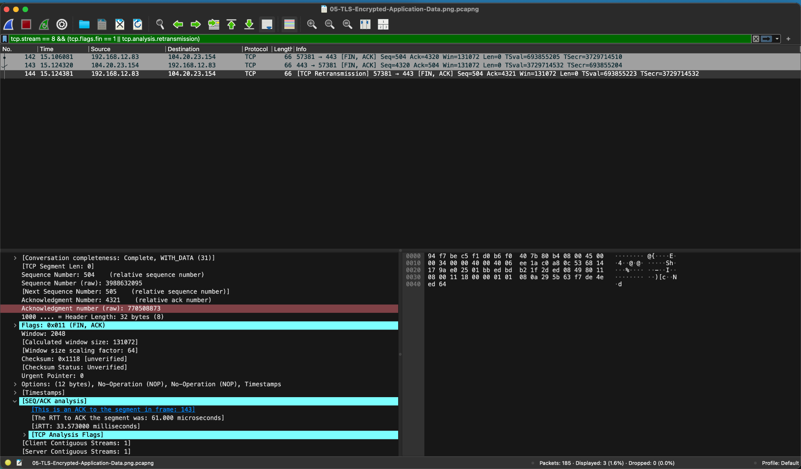

# Wireshark Network Traffic Analysis

## Project Overview

This project demonstrates practical network traffic analysis using Wireshark to inspect network communication, identify protocol behavior, investigate encrypted connections, and examine TCP connection termination.

The project focuses on packet-level analysis relevant to Security Operations Center (SOC) analysts, cybersecurity analysts, and network security professionals.

## Objectives

- Capture and inspect network traffic using Wireshark.
- Analyze ICMP echo requests and replies.
- Investigate DNS traffic and name resolution.
- Understand TCP connection establishment and termination.
- Examine TLS Client Hello and Server Hello messages.
- Identify encrypted TLS application data.
- Recognize TCP retransmissions and potential network reliability issues.

## Tools and Technologies

- Wireshark
- macOS Terminal
- TCP/IP networking
- ICMP, DNS, TCP, TLS, and HTTPS
- Git and GitHub

## Project Structure

```text
Wireshark-Network-Traffic-Analysis/
├── captures/
│   ├── 01-ICMP-Packet-Analysis.pcapng
│   ├── 02-DNS-Packet-Analysis.pcapng
│   ├── 03-TCP-Three-Way-Handshake.pcapng
│   ├── 04-TLS-Server-Hello-Analysis.pcapng
│   ├── 05-TLS-Encrypted-Application-Data.pcapng
│   └── 06-TCP-Connection-Termination-Retransmission.pcapng
├── screenshots/
│   ├── 01-ICMP-Echo-Request-Reply.png
│   ├── 02-TLS-Client-Hello.png
│   ├── 03-TLS-Server-Hello.png
│   ├── 04-TLS-Change-Cipher-Spec.png
│   ├── 05-TLS-Encrypted-Application-Data.png
│   └── 06-TCP-Termination-Retransmission.png
├── .gitignore
└── README.md
```

## Investigation 1: ICMP Traffic Analysis

**Objective:** Examine ICMP echo requests, replies, and network connectivity behavior.

**Observations:**
- Source: `192.168.12.83`
- Destination: `8.8.8.8`
- ICMP echo requests received corresponding replies.
- Additional ICMP destination-unreachable messages were observed.

**Security relevance:** ICMP analysis helps analysts troubleshoot connectivity, investigate network reconnaissance, and identify unusual diagnostic traffic.



## Investigation 2: TLS Client Hello

**Objective:** Examine the initiation of an encrypted TLS connection.

**Observations:**
- Client: `192.168.12.83`
- Server: `104.20.23.154`
- Destination port: `443`
- Server Name Indication (SNI): `example.com`
- The Client Hello advertised supported TLS versions and cipher suites.

**Security relevance:** TLS handshake metadata can help analysts identify unusual client behavior, investigate connection destinations, and assess encryption configurations.



## Investigation 3: TLS Server Hello

**Objective:** Inspect the server response during TLS negotiation.

**Observations:**
- The server selected TLS 1.3.
- Negotiated cipher suite: `TLS_CHACHA20_POLY1305_SHA256`.
- The Server Hello included a key-share extension using X25519.

**Security relevance:** Examining negotiated cryptographic parameters helps identify outdated protocols, weak encryption configurations, and unexpected TLS behavior.



## Investigation 4: TLS Change Cipher Spec

**Objective:** Identify Change Cipher Spec records during TLS connection establishment.

**Observations:**
- Change Cipher Spec records were visible during the TLS 1.3 handshake.
- TLS 1.3 may include compatibility Change Cipher Spec records to support interoperability with legacy TLS implementations and middleboxes. These records do not change the negotiated cipher suite or activate encryption.

**Security relevance:** Understanding TLS record types helps distinguish expected protocol behavior from potentially suspicious handshake anomalies.



## Investigation 5: Encrypted TLS Application Data

**Objective:** Examine encrypted network communication after TLS negotiation.

**Observations:**
- TLS application data records were observed over TCP port 443.
- Application payloads were encrypted.
- Wireshark displayed encrypted record metadata without exposing plaintext application content.

**Security relevance:** SOC analysts frequently investigate encrypted traffic using connection metadata, packet sizes, timing, endpoints, and protocol behavior.



## Investigation 6: TCP Connection Termination and Retransmission

**Objective:** Investigate TCP session termination and retransmission behavior.

**Observations:**
- TCP FIN/ACK packets were observed.
- Both endpoints participated in connection termination.
- Wireshark identified a retransmitted FIN/ACK packet.
- The capture illustrates how retransmissions can occur during connection teardown.

**Security relevance:** TCP analysis supports troubleshooting network reliability, investigating interrupted sessions, and distinguishing network issues from potentially suspicious traffic patterns.



## Wireshark Display Filters

| Investigation | Display Filter |
|---|---|
| ICMP traffic | `icmp` |
| DNS traffic | `dns` |
| TCP SYN packets | `tcp.flags.syn == 1` |
| TLS Client Hello | `tls.handshake.type == 1` |
| TLS Server Hello | `tls.handshake.type == 2` |
| TLS Change Cipher Spec | `tls.record.content_type == 20` |
| TLS application data | `tls.record.content_type == 23` |
| TCP retransmissions | `tcp.analysis.retransmission` |
| TCP connection termination | `tcp.flags.fin == 1` |

## Key Skills Demonstrated

- Network packet inspection
- Protocol analysis
- TCP/IP troubleshooting
- TLS handshake investigation
- Encrypted traffic analysis
- Network anomaly identification
- Technical evidence collection
- Cybersecurity documentation

## Conclusion

This project demonstrates foundational network traffic analysis skills through practical Wireshark investigations.

The collected packet captures and supporting screenshots provide reproducible evidence of protocol behavior and support the development of network security monitoring and SOC investigation skills.

**Note:** Observed network anomalies do not independently establish malicious activity. Additional context and correlation are required for security incident classification.
